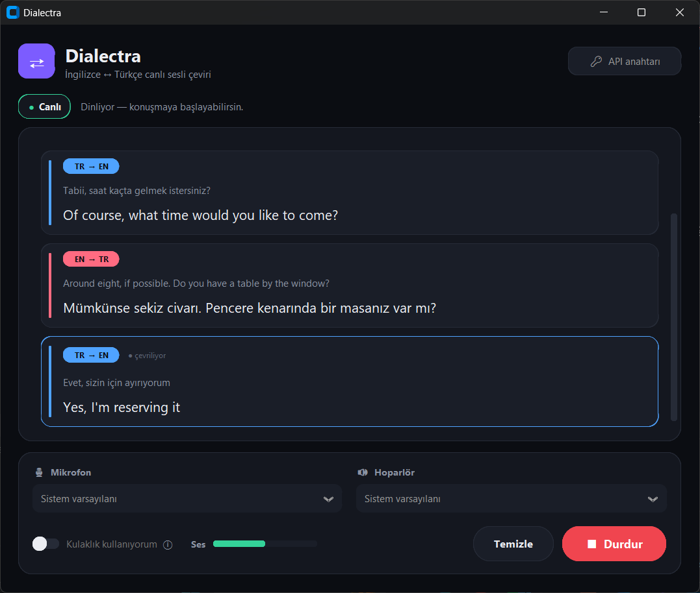
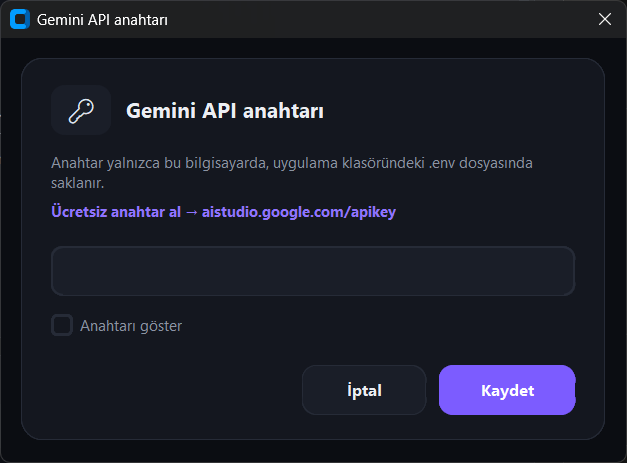

# Dialectra

[Türkçe](README.md) | **English**

Real-time English ↔ Turkish voice translator for Windows. Speak English or
Turkish into the microphone; the translation plays through the speakers and
appears on screen as subtitles. Translation is done by
[Gemini 3.5 Live Translate](https://ai.google.dev/gemini-api/docs/live-api/live-translate).



## Usage

1. Get a free API key from [Google AI Studio](https://aistudio.google.com/apikey).
2. Open `Dialectra.exe` and save the key with the **API anahtarı** (API key) button.
3. Press **Başlat** (Start) and speak.



## Development

```bash
python -m venv .venv
.venv\Scripts\python -m pip install -r requirements.txt
.venv\Scripts\python dialectra.py
```

Building the `.exe`:

```bash
.venv\Scripts\pyinstaller dialectra.py --noconfirm --onefile --windowed --name Dialectra --collect-data customtkinter --workpath .build --distpath dist --specpath .build
```
