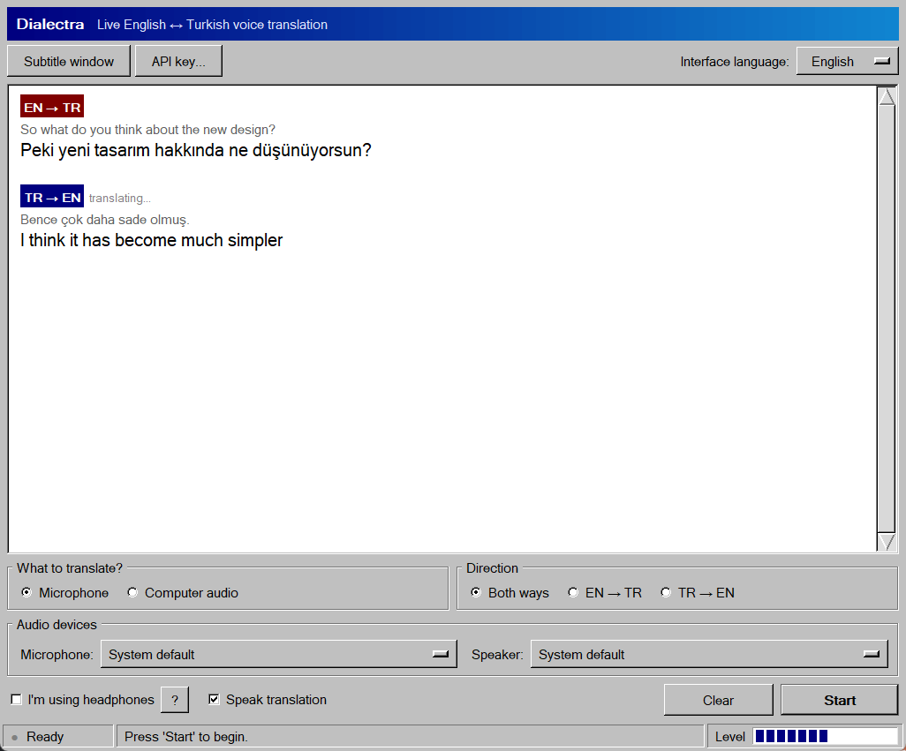
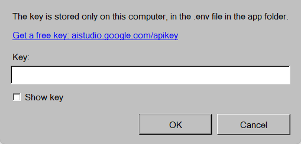

# Dialectra

[Türkçe](README.md) | **English**

Live English ↔ Turkish voice translation for Windows. It translates what is
spoken into the microphone or whatever the computer is playing (YouTube,
meetings, shows); the translation plays through the speakers and appears on
screen as subtitles. Translation is done by
[Gemini 3.5 Live Translate](https://ai.google.dev/gemini-api/docs/live-api/live-translate).



## Usage

1. Get a free API key from [Google AI Studio](https://aistudio.google.com/apikey).
2. Open `Dialectra.exe` and save the key with the **API key...** button.
3. Press **Start** and speak.

The interface opens in English on Windows systems that are not set to Turkish;
you can switch it any time with **Interface language**.



## Options

- **What to translate?** The microphone or computer audio. In computer-audio mode
  Dialectra's own sound is never captured, so the translation can play on the same
  headphones (Windows 10 2004 or later).
- **Direction:** both ways, or only EN → TR / TR → EN. One direction uses half of the free quota.
- **I'm using headphones:** without headphones, the translation coming out of the
  speakers is kept from looping back into the microphone.
- **Speak translation:** when off, only subtitles are shown.
- **Subtitle window:** an always-on-top window. Drag to move, scroll to change the text size.
- **Interface language:** Türkçe or English.
- **Ctrl+Alt+D:** start / stop while the app is in the background.

## Known limitations

- Gemini reads the translation in a voice modeled on the speaker's and does not allow
  choosing a voice, so the voice can switch between female and male.
- Gemini sometimes transcribes speech in the wrong language. Dialectra hides those
  lines; the translation itself is not affected.

## Development

```bash
python -m venv .venv
.venv\Scripts\python -m pip install -r requirements.txt
.venv\Scripts\python dialectra.py
```

Tests:

```bash
.venv\Scripts\python -m unittest discover tests
```

Building the `.exe`:

```bash
.venv\Scripts\pyinstaller dialectra.py --noconfirm --onefile --windowed --name Dialectra --workpath .build --distpath dist --specpath .build
```

Pushing a tag that starts with `v` (e.g. `v1.1.0`) makes GitHub Actions build the
`.exe` and attach it to a Release. Licenses of the bundled packages are in
`THIRD_PARTY_LICENSES.txt` on the Release.
